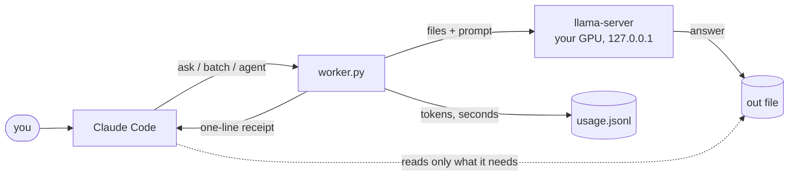

# cranker-llm


**Claude thinks, your GPU cranks.**

Most of what an AI coding agent spends goes on *reading*: the 3,000-line file it opens to find one function, the
log it scrolls through, the forty files it greps to learn who calls what. cranker-llm is a Claude Code plugin that
hands that grind to a model running on your own GPU (llama.cpp) and keeps it out of Claude's context. Claude gets
back a one-line receipt and a file, reads only what it needs from it, and checks what it uses.

In its first eleven hours of real use, on two game decompilations, it read **2.4 million tokens** so that Claude
did not have to, and kept **1.95 million** off Claude's context: between **$7.80 and $34.06** at API list prices,
or the same tokens off a subscription's usage limits.

Nothing leaves your machine: the server listens on 127.0.0.1 only.



## What it looks like

Claude asks the worker for a map of a C file:

```
py scripts/worker.py ask -f bench/sample.c -o map.md \
   -p "For each function, in order, one line: `name` (line N): what it does, concretely. Nothing else."
```

and gets back one line, not the file:

```
-> map.md: in 934 tok (846 tok/s), out 220 tok (18.8 tok/s), 162.9 s
```

(162 seconds because it waited for room behind four other requests that evening; alone on the server, 220 tokens
at ~30 tok/s take about seven.) `map.md`, exactly as the model wrote it:

```
queue_empty (line 24): returns 1 if the circular queue is empty (head equals tail), else 0
queue_push (line 29): adds a floor to the queue if it is not full and not already present, ignoring invalid floors
queue_pop (line 43): removes and returns the floor at the head of the queue, advancing the head pointer
elevator_init (line 50): zero-initializes the elevator structure and sets its state to IDLE
elevator_call (line 56): queues a floor request if the elevator is not out of service
next_state (line 64): computes the next state based on current position, target, and queue status
elevator_step (line 78): advances the elevator simulation by one frame, updating floor, door timer, and state
elevator_run (line 112): calls elevator_step for the specified number of frames
elevator_fault (line 118): sets the elevator to OUT_OF_SERVICE, clears the queue, and executes one step
```

Every description holds up (the one for `elevator_step` leaves out the trip count). Six of the nine line numbers
are off by 1 to 7, and the last one is past the end of the 116-line file. That is the deal: **the worker drafts,
Claude checks.** The skill tells Claude to verify every `file:line` and every fact before it uses one, and checking
a draft costs far less than reading the file.

## Quick start

In Claude Code:

```
/plugin marketplace add cheviman/cranker-llm
/plugin install cranker-llm@cranker-llm
```

Then ask Claude to set it up. The skill makes it show you what it would download (files, sizes, sources) and wait
for your yes. Or do it yourself in a terminal (Python 3.10 or newer, standard library only; `python3` instead of
`py` outside Windows):

```
cd ~/.claude/plugins/cache/cranker-llm/cranker-llm/1.1.0
py scripts/setup.py                                           # the models that fit your GPU
py scripts/setup.py --profile qwen3.8-27b-q4kxl --dry-run     # what it would download
py scripts/setup.py --profile qwen3.8-27b-q4kxl               # download and configure
py scripts/worker.py start
```

Models, binaries, logs and config live in `CRANKER_HOME` (`~/.cranker-llm` by default), never inside the plugin.
Already have the model or llama-server? `--model-path` checks your file's SHA-256 against the profile, and
`--llama-server` uses your binary. On Linux and macOS, install llama.cpp b12421 or newer yourself (a CUDA, Metal or
Vulkan build); the setup downloads it only on Windows.

`/worker-status` says whether it is running and what it saved today; `/worker-usage` gives the whole bill.

## Three ways in

**`ask`**: files and an instruction in, the answer to a file. Line ranges work (`-f src/big.c:120-260`).

```
py scripts/worker.py ask -f src/big.c -o map.md -p "..."
py scripts/worker.py ask -f diff.txt -o review.md --think --effort medium -p "..."
```

**`batch`**: many tasks in parallel, one JSON object a line. Eight slots run at once (~118 tok/s in all on a 3090,
against ~30 for one request). Tasks whose output exists are skipped, so a batch can be stopped and resumed.

```
{"id": "f1", "prompt": "Propose a name for this function...", "files": ["src/a.c:100-180"], "out": "names/f1.md"}
```

**`agent`**: Claude Code itself, headless, running on the local model, with Read, Grep and Glob, and Write and Edit
inside its own folder only. For "find everything that touches X across these folders and put it together", not
for writing code: a turn has 8,000 tokens with its thinking (capped at 4,096), and code is better written by `ask`
or `batch` with a check. It loads none of your Claude Code settings (no hooks, plugins, CLAUDE.md or MCP servers).

```
py scripts/worker.py agent --dir src --dir include -o answer.md -p "Who writes to e->state? file:line for each."
```

### The check: the worker does its own rework

The model can't compile or run anything, so without a check every round of rework goes back through Claude:
compile, read the errors, write a prompt for each one, send it again. In one port that took 704 tasks in 26 rounds.
With a `check`, the worker runs the command itself, hands the model its own output with the errors, and repeats
until it passes or runs out of `check_retries` (2 by default; from the second fix on, the model thinks first). The
check is any command that exits 0 when the output is right, with `{out}` standing for the output's path. It runs in
the caller's folder, several at once in a batch, so it must write only files of its own. An answer that is one
fenced code block and nothing else (`` ```c ... ``` ``) is written to `-o` or `out` without its fence, so the check
sees the code and not the fence; any other answer (prose, a markdown file with several blocks) is written as it came.

```
py scripts/worker.py ask --prompt-file spec.txt -o slug.py --check "py test_slug.py {out}"
py scripts/worker.py batch fixes.jsonl --check "py build_chunk.py {out}" --prompt-prefix rules.txt
```

Each output ends one of three ways: `check passed`, `check passed after N fixes by the worker`, or `CHECK FAILED`
with the last errors in `<out>.check.txt`, left for Claude. `usage` adds them up by project (first time / by the
worker / for Claude). In a `batch`, `--check`, `--retries`, `--system-file` and `--prompt-prefix` apply to every
task that doesn't set its own, so the shared rules are written once and not in every line.

An answer cut by `max_tokens` is unfinished whatever its check says, and the check's errors on it are only about
the missing end. So a cut answer is asked for again as it was, with 1.5 times the limit (as far as the context
holds it beside the prompt; with `--think` the thinking budget stays and the extra goes to the answer), once. The
task's line and its `.check.txt` start with `cut by max_tokens N`, and say `max_tokens raised N -> M` when the
retry took it. Cut again, or with no room to raise it, the task stops there: it `needs splitting`. When a plain fix
moves to thinking, the answer keeps the room it had and the thinking budget comes on top.

### The brief: how you work there

The worker loads no `CLAUDE.md`. Your full one wouldn't help anyway: it's written for Claude and would fill the
shared context. Instead, `.cranker/brief.md` in the project (found in the caller's folder or above it, up to the
repository's root and never past it; outside a repository, only in the caller's folder) goes into the system prompt
of every `ask`, `batch` and `agent`. A brief is instructions to the model, like a CLAUDE.md: a repo you don't trust
gets `--brief ""`. Keep it to the rules the code must follow:
language, indentation, headers and markers, what never to do. `--brief FILE` uses another file, and `--brief ""`
leaves it out. With a four-line brief, the same request for a C function went from spaces and no markers to tabs
and `//ok, DD-MM-YYYY`, and passed a style check the first time.

### What to hand it, and what not

| Hand it | Measured (Qwen3.8-27B Q4_K_XL, RTX 3090) |
|---|---|
| A map of a long file before reading it | 666 lines of C: 25 of 25 functions, 22 accurately, 40 s |
| Who defines and who calls X | exact `file:line`, 2-4 agent turns, 13-25 s |
| Names for unnamed functions, in bulk | with two neighbours as examples: 4 of 12 exact, 4 near |
| Mechanical rewrites | 180 tok/s with ngram speculation, identical to the plain run |
| Long logs: what failed and why | ~30 tok/s a request, ~118 tok/s in all in a batch |
| A search over two folders, ~20 files | 20 agent turns, 11 minutes, exact |

Keep for Claude: decisions, stateful debugging, anything that weighs several things at once, anything that goes
into the repo without a mechanical check, and text a person will read as is.

## Which model

| Profile | GPU | Status | Use it for |
|---|---|---|---|
| `qwen3.8-27b-q4kxl`: Qwen3.8-27B UD-Q4_K_XL (unsloth), 17.7 GB | 24 GB | measured | everything: the default |
| `bonsai2-27b-q2_0`: Ternary Bonsai 2 27B Q2_0 (PrismML), 7.6 GB | 12 GB and up | measured on 24 GB only | reading in volume, and speed; not exact edits |
| `qwen3.8-27b-iq3s`: Qwen3.8-27B UD-IQ3_S (unsloth), 12.0 GB | 16 GB | untested | |

Everything here was measured on one machine: an RTX 3090 (24 GB) at 260 W, on Windows 11, on 15 and 16 November
2026. Other GPUs and the Linux and macOS paths are not measured yet; numbers from yours are welcome (see
"Benchmark your machine").

<details>
<summary><b>Untested candidates</b>: smaller cards, mixtures of experts, Macs</summary>

Nothing in this table has been run with cranker-llm. The sizes are the files' on Hugging Face (16-11-2026); the
"why" is a reason to try one, not a result. Run `bench/bench.py` on one and the numbers can become a profile. To try
one by hand, point `model` in the config at it, and `extra` for any server options.

| Model (repo) | File, size | GPU | Why try it | The catch |
|---|---|---|---|---|
| Qwen3.6-35B-A3B UD-Q3_K_XL (unsloth/Qwen3.6-35B-A3B-GGUF) | 16.9 GB | 24 GB | A mixture of experts with 3B active a token: it should be several times faster than the dense 27B | An older generation, weaker than Qwen3.8-27B; 3-bit |
| Qwen3.6-35B-A3B UD-IQ3_S or UD-Q2_K_XL (same repo) | 13.7 / 12.3 GB | 16 GB | The same speed on a 16 GB card | 2-3 bit on top of the above |
| Qwen3.6-35B-A3B UD-Q4_K_XL, experts in system RAM (`extra: ["--n-cpu-moe", "20"]`) | 22.4 GB | 12-16 GB, with 32 GB of RAM | 4-bit quality on a smaller card: only 3B a token cross to the CPU | Slower than all on the GPU; how many layers to move is a measurement to make |
| Qwen3.8-27B UD-IQ2_XXS (unsloth/Qwen3.8-27B-GGUF) | 7.2 GB | 10-12 GB | The 27B on a 12 GB card | 2-bit quants of an ordinary model lose a lot; Bonsai 2 27B Q2_0 (7.6 GB, in the profiles) was trained for that size |
| Ternary Bonsai 2 9B Q2_0 (prism-ml/Ternary-Bonsai-2-9B-gguf) | 2.6 GB | 6-8 GB | Room for a long context on a small card; runs on stock llama.cpp | A 9B: weaker than any 27B, and the 27B's weakness at exact edits is to be expected |
| Ternary Bonsai 2 4B Q2_0 (prism-ml/Ternary-Bonsai-2-4B-gguf) | 1.2 GB | 4 GB, or the CPU | Maps and log summaries on almost anything | A 4B: check everything it says |

**Mac (Apple Silicon):** use the same GGUF files with llama.cpp's Metal build (Homebrew's `llama.cpp`), and size by
unified memory: Qwen3.8-27B UD-Q4_K_XL wants 32 GB or more, Bonsai 2 27B Q2_0 16 GB, Bonsai 2 9B 8 GB. The MLX builds
(mlx-community/Qwen3.8-27B-4bit, 16.1 GB; prism-ml's Bonsai 2 mlx-2bit, 8.6 GB for the 27B) do not work with
`worker.py`: it needs llama-server's `/slots`, `/tokenize` and `/props`.

**Bigger than the GPU:** Qwen3.8-Flash-Next is a 125B mixture of experts with 6B active a token. With its experts in
system RAM (`--n-cpu-moe`) it might run on a 24 GB card with 64 GB or more of RAM. Not looked at beyond its model
card.

</details>

### Measured (RTX 3090 at 260 W)

| | Qwen3.8-27B UD-Q4_K_XL | Bonsai 2 Q2_0 | Bonsai 2 PTQ1_0 (PrismML's llama.cpp fork) |
|---|---|---|---|
| File | 17.7 GB | 7.6 GB | 5.9 GB |
| GPU memory, 64K context (with the desktop's) | 23.0 GB with 4 slots, 21.2 GB with 8* | 11.4 GB | 9.7 GB |
| One request | 30.7 tok/s | 58.4 tok/s | 81.1 tok/s |
| 4 / 8 / 16 requests at once (`llama-batched-bench`) | 107 / 185 / 275 tok/s | 121 / 150 / 292 | 184 / 206 / 302 |
| Summary of a 666-line C file, one line a function | 47 s, 25 of 25 | 28 s, 25 of 25 | 24 s, 25 of 25 |
| Agent: who defines and calls a function | exact, 2-4 turns | exact, 4 turns | exact, 2 turns |
| Rename a local in 120 lines of C, exactly | 6 of 6 | 3 of 6 | 2 of 4 |

\* The desktop's own use moved between 1 and 3.8 GB that evening.

- **Bonsai reads as well as Qwen but edits worse.** Its summaries said the same things, and its names were as
  good (they vary more from run to run than between the models). Asked for an exact edit, it gave the code back
  unchanged half the time.
- **Slots:** in the worker's own batches (16 explanations), 4 slots gave 72-82 tok/s in all, 8 gave 98-128 and 16
  gave 127-158. The default is 8; 16 left only ~2 GB of the GPU free.
- **On this card PTQ1_0 was the fastest Bonsai pack**, against the model card, which expects PQ2_0 to win on
  Ampere (here PQ2_0 gave 62 tok/s). PTQ1_0 needs PrismML's fork (github.com/PrismML-Eng/llama.cpp), so no
  profile uses it: point `llama_server` and `model` at it by hand.

## The read guard

The skill tells Claude to map a long file before reading it, and sometimes Claude reads it whole anyway. The
plugin's hook catches those reads: in the folders you list, a whole-file Read of a text file over 300 lines is
turned away, with the command to map it with the worker. A Read of a range (`offset`, `limit`) always goes through,
which is also how Claude reads a file whole when it really needs to.

It does nothing until you list folders, so the work you do not want slowed down stays as it is. In
`CRANKER_HOME/config.json`:

```json
"read_guard": {"roots": ["D:/projects/personal"], "max_lines": 300}
```

Every refusal is logged, and `worker.py usage` counts them.

## Measuring the savings

Every `ask`, `batch` task and `agent` run adds a line to `usage.jsonl`: the time, the command, the caller's folder,
the model, the tokens read (`in`), written (`out`, thinking included) and given back (`answer`), and the seconds.
`py scripts/worker.py usage [--since 2026-11-16]` adds them up by command, project and day. The author's first
eleven hours:

```
command                            requests          in       out    answer  kept off Claude  hours
batch                                   566   2,331,303   541,740   457,321        1,873,982   13.7
ask                                       7      79,492    57,367     4,467           75,025    1.0
total                                   573   2,410,795   599,107   461,788        1,949,007   14.7

USD saved at API list prices          Opus 5.5 read   Fable 5.2 read  Opus 5.5 +write Fable 5.2 +write
total                                          7.80            15.59            17.03            34.06
```

- **kept off Claude** is `in - answer`: what the model read so that Claude did not. For the agent it is an upper
  bound, because its `in` counts Claude Code's own prompt again on every turn.
- **read** prices that at the input price; **+write** also prices the answers at the output price, as if Claude
  had written them (names, comments, drafts). For maps and summaries Claude would only have read the files, so the
  truth lies between the two. Prices are `PRICES` in `worker.py`.
- Neither counts that Claude Code sends what it has read again on every later turn, at the cache-read price: a file
  read early in a long session is paid for more than once.
- **hours** adds up each request's time; requests run in parallel, so the wall clock was shorter.
- On a subscription, the same tokens come off its usage limits instead of a bill.
- **Consumed is not effective.** A run that read and gave nothing back (an agent the worker stopped or that ended
  in an error, an empty answer) is in `in`, `out` and `hours`, because it was consumed, and not in "kept off
  Claude" or the savings. `usage` says how much of each there was. One day's two failed agents had read 505K tokens
  and were reported as 505K saved.
- **`usage --session`** shows only the calling Claude Code session's requests (or `--session ID`). Asked how much
  the worker had done in a session, Claude answered with every project's total; `/worker-usage` now leads with the
  session's own.

Benchmarks run with `CRANKER_USAGE_TAG=bench` and stay out of the totals unless `--all`.

## The scale

Left to itself, Claude hands the worker what is easy to hand over, not what is heavy. One session spent six hours
giving it accents and single lines, and on 16-11-2026 the author's sessions had Claude write 10.2M new tokens
against the worker's 4.5M. So the plugin keeps a scale: `ratio` local tokens for each token of Claude, 5 by default
(a million local for 200K of Claude). It is a target, not a rule, and nothing is ever blocked.

```
py scripts/local_share.py [--day 2026-11-16]
```

```
2026-11-16: Claude 10,184,572 new tokens, the local worker 4,482,374: 0.44 to 1 (the scale: 5 to 1, 50,922,860 local)

session   project (where it started)                    Claude       local   ratio
42d6ebdd  D:\Vsworkspace\somos                       2,416,567           0    0.00
533ec8bd  D:\vs-cheviman\outrunners                  1,046,201           0    0.00
```

- **Claude's tokens** are what each turn adds, from Claude Code's own transcripts: input, cache writes and output,
  one count per message, subagents included. Cache reads are left out, because they are the same context sent again
  on every turn: that day they came to 800M against the 10M new.
- **The worker's** are `in` + `out` from `usage.jsonl`. Every request logs the Claude Code session that made it, so
  each session's share is exact. That is what it consumed; the scale is measured on the effective part, without
  the runs that read and gave nothing back, and `local_share.py` shows both. Tokens that only burnt don't move it.
- **The hook** (`PostToolUse` on Read, Grep, Glob, Edit, Write and Agent, and `UserPromptSubmit`): when a session that
  has used the worker is below the scale, it adds a note to Claude's context with the session's numbers and what
  counts as real load. That means first drafts of the code Claude is about to write (for Claude to review), maps,
  searches across many files, diff reviews, logs, and names and comments in batch. Accents and single lines don't
  count. It waits until the session has spent 150K tokens of Claude, and then notes at most every 15 minutes.

```json
"scale": {"ratio": 5, "roots": ["D:/projects/personal"], "floor": 150000, "every_min": 15}
```

In the folders under `roots` the note comes even before the session has used the worker. `ratio` 0 turns the hook
off, and `CRANKER_RATIO` overrides it.

## Things learned the hard way

- **Qwen3's chat template raises on a system message after the first one**, and Claude Code sends them. Without a
  fix, the agent's first request fails with HTTP 500. `worker.py start` patches a copy of the template so the
  message renders in place, then restarts once.
- **`claude --bare` leaves the agent only Read and Edit.** The agent uses `--setting-sources ""` and
  `--strict-mcp-config` instead, which keep the tools but none of your configuration.
- **Tell Claude Code the real context size.** It assumes a larger one and never compacts: one agent asked for
  68.9K of a 64K context on its 33rd turn. `CLAUDE_CODE_MAX_CONTEXT_TOKENS` and `CLAUDE_CODE_AUTO_COMPACT_WINDOW`
  fix that.
- **All slots share one context pool (`-kvu`).** When it overflows, llama-server does not refuse the new request;
  it fails every running one. So `ask` and `batch` count a request with the server's tokenizer and wait for room,
  and an agent (32-40K a request, growing with every file it reads) runs alone.
- **Count the requests one at a time.** `/slots` shows a request only once the server takes it, so a batch's
  threads that found the server idle in the same second all went in: 88K of answers on a 64K pool. With the pool
  full, llama-server halves its batch down to 8 tokens and the ngram drafts fall outside it ("speculative batch
  index 8 is not inside the current sub-batch"). Now a request waits for the one before it to show in `/slots`
  (a lock shared by all the worker's processes), and that error is retried like a full pool.
- **When the GPU's memory overflows on Windows, the driver moves it to system RAM and everything crawls** (a few
  tok/s), with no error. A DFlash 2 drafter beside the 17.7 GB model and its 64K context did exactly that. The
  same drafter was right 0 % of the time on Bonsai, whose rotated weights change the hidden states it reads.
- **Thinking counts inside `max_tokens`, and Qwen thinks a lot.** A diff review spent 10,000 tokens thinking and
  returned nothing; two diagnoses did the same with 14,000. llama-server takes a thinking budget per request
  (`reasoning_budget_tokens`, with `reasoning_budget_message`), so `worker.py` gives every `--think` request one,
  leaving up to 2,048 tokens for the answer: past it, the server closes the thinking and the model answers. If an
  answer still comes back empty, the worker sends the cut thinking back and asks for the conclusion, and says
  `RECOVERED` so the answer gets checked. Maps and summaries run without `--think`.
- **Claude Code asks for adaptive thinking, and llama-server reads that as no limit.** Three agents asked to write
  a test against its reference spent 25 to 45 minutes each and wrote nothing: before writing, Qwen thought past
  the agent's 8,000-token turn, Claude Code asked it to resume, the cut thinking was dropped and the model thought
  again from scratch, four or five times, until an API error, the timeout or a context overflow. Claude Code has no
  setting that changes it (`MAX_THINKING_TOKENS`, the effort level), while `"thinking": {"type": "enabled",
  "budget_tokens": N}` is honoured. So the agent talks to a relay inside `worker.py` that gives every request that
  budget (`agent_think_budget`, 4,096), drops the thinking of earlier turns from the context, and stops the agent
  when two turns in a row are cut before it acts. With it, one of those three tasks ran to the end: 23 turns, 34
  minutes, no turn cut, its three files written.
- **Claude fixes a wrong output itself rather than send it again, and then writes the worker off.** After those
  three agents, the session noted "the worker's agents are no good for writing tests" in its memory. The cause was
  one setting. Now a failed `ask`, `batch` or `agent` ends with a `next:` line: send it again with something
  changed (`--think`, more `--max-tokens`, a narrower task, a `--check`), say so when the limit is the worker's
  own, and don't take one failure for what the worker can't do. The skill and the scale's note say the same.
- **An agent takes the worker from every session, and nothing said whose it was.** While one ran for 34 minutes,
  another session's batches waited their 30 and ended as failed, with "an agent is running". Now the agent leaves
  a note (its session, its folder, when it started, its time limit, how its prompt begins), and a task that waits
  says it: `an agent of session 601d636d (vs-cheviman\saturn-fullset; 12 min in, 33 min left at most; "Write a
  test for...") has the worker`. `status` says it too. A task that waited the whole time ends as `not run`, not
  as failed (`WAIT` in a batch, counted apart): nothing is wrong with it, and the same command again picks it up.
- **A check that only parses proves that it parses.** The relay's first draft passed "it is valid Python" and
  failed on every request; sent back with the failure and a test that runs it, the next draft passed.
- **A cut answer looked like a wrong one.** A batch task (`max_tokens` 12,000, `--retries 3`) wrote a CMake file
  in two parts; the check said the second was missing, four times, and nothing said the answer had been cut. Its
  first answers weren't (3,241 and 4,085 tokens): the fixes that think went to the thinking default, 10,000 with
  7,952 of it to think, and had 2,048 left to write the whole file again in, cut at line 206. Now a fix that thinks
  keeps the answer's room, a cut answer is asked for again with more, and its line says so first
  (`tests/test_cut.py`).
- **A rule to delegate is not enough; a number is.** With only the skill's guidance, Claude kept the heavy work and
  handed over the light. The scale and its note in the session's own context (see above) put a number on it.
- **ngram speculation** (`--spec-type ngram-mod`) costs nothing on free text and makes rewrites 5x faster.
- **A worker's batch threads must not probe a file lock together**: they mistook each other's probe for a running
  agent.
- **Hugging Face throttles some files on one connection** (0.4 MB/s, against 24 MB/s on eight), so the setup
  downloads in ranges.
- **Windows PowerShell 5.1 splits `-p "..."` with `\"` inside** into several arguments. Use `--prompt-file`.
- **An LLM loads the GPU's memory harder than a game does.** On the 3090, within 90 s of batches the fan reached
  100 % and the GPU slowed itself down with the core at only 69 C, so the GDDR6X was at its limit. `batch` waits
  while the GPU reports thermal slowdown. Raising the power limit does not help while the memory is that hot: at
  350 W the card spent 86 % of the time in thermal slowdown, and the batches were no faster than at 260 W.
  `max_power_w` in the config makes `start` refuse above a limit.
- **If the machine shuts down hard under GPU load, check the GPU's power connectors first.** This one lost video and
  rebooted (Kernel-Power 41, no bugcheck) eight times over eight months. A new 1000 W power supply and a new CPU
  did not fix it. The cause was the card's second 8-pin connector, not pushed all the way in. The Eagle draws 350 W
  through two 150 W connectors and the 75 W slot, which leaves 25 W of headroom, and loading a model is one of its
  spikes. Seated, it ran ten minutes at 350 W (399 W peaks), with both connectors sharing evenly (112 and 108 W on
  average) and never below 11.83 V. HWiNFO shows each connector's power and voltage under "GPU rail powers".

## Benchmark your machine

`bench/bench.py` runs against the server that is running (it never starts or stops it): a file map, an exact
rename checked against a diff computed in code, an agent search and a batch of 16, all on `bench/sample.c`, a small
elevator controller written for it. The report goes to `bench/runs/<tag>/`. Numbers from other GPUs are the most
useful thing you can send back.

## Files and settings

| Path | What |
|---|---|
| `.claude-plugin/` | plugin and marketplace manifests |
| `skills/cranker-llm/SKILL.md` | when and how Claude uses the worker, and how it checks what comes back |
| `commands/` | `/worker-status`, `/worker-usage` |
| `hooks/hooks.json`, `scripts/read_guard.py` | the read guard (off until `read_guard.roots` lists folders) |
| `hooks/hooks.json`, `scripts/local_share.py` | the scale: the day's report, and the note to sessions below it |
| `scripts/worker.py` | start, stop, status, config, ask, batch, agent, usage |
| `scripts/setup.py` | profiles, downloads with SHA-256, config |
| `profiles/profiles.json` | the models, with what was measured on each |
| `bench/bench.py`, `bench/sample.c` | the benchmarks |

Settings are in `CRANKER_HOME/config.json`: `model`, `llama_server`, `template`, `alias`, `port`, `ctx`, `parallel`,
`cache_type`, `spec`, `threads`, `max_power_w`, `thermal_pause`, `read_guard`, `scale`, `extra` (more llama-server
options), `system`, `sampling`, `max_tokens`, `check_retries`, `check_timeout`. `worker.py config` prints the
values in effect. These environment variables override them: `CRANKER_MODEL`, `CRANKER_SERVER`, `CRANKER_TEMPLATE`,
`CRANKER_PORT`, `CRANKER_CTX`, `CRANKER_PARALLEL`, `CRANKER_SPEC`, `CRANKER_EXTRA`, `CRANKER_RATIO`. `CRANKER_BRIEF`
names the brief (or `none`). A project's brief is `.cranker/brief.md`.

## Where it came from

It grew out of decompiling arcade games to C with Claude Code (simpsons-decomp, tmnt-port and others), where most
of the tokens went on reading assembly, maps and logs, and the weekly limit had to be shared with a day job.

## Licence

BSD 3-Clause (`LICENSE`). Nothing third-party ships here. llama.cpp (MIT, ggml-org) and the models are downloaded
from their own sources under their own licences: Qwen3.8-27B is Apache 2.0 (Alibaba Cloud), with GGUF files by
unsloth; Ternary Bonsai 2 is Apache 2.0 (Prism ML).
